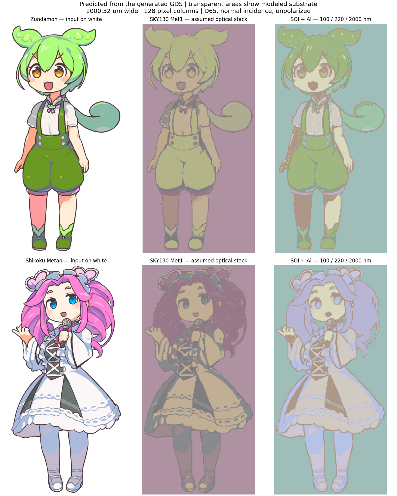
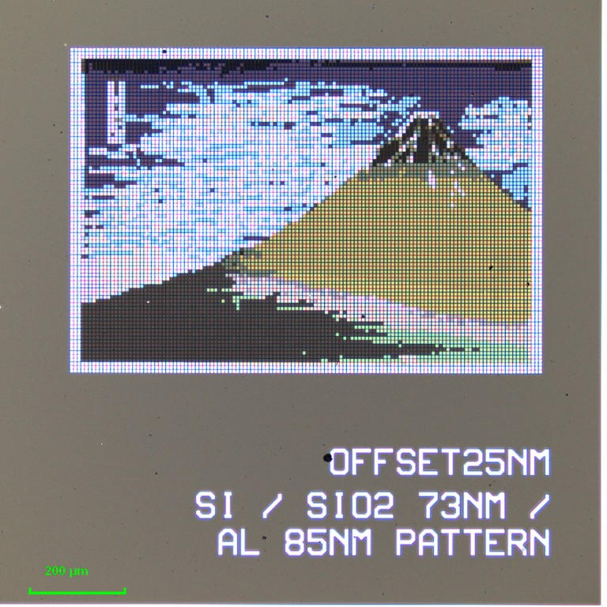
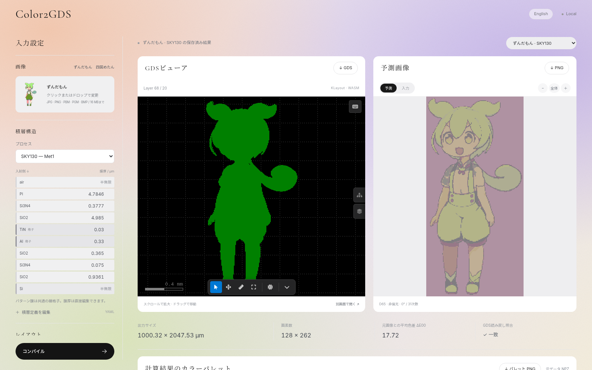

# Color2GDS

[](LICENSE)

[English](README.md) | **日本語**

**画像と積層構造から、構造色で画像を表示するGDSIIレイアウトと、その見え方の予測を生成するコンパイラです。**

CMOSの配線層にサブ波長の金属線格子を配置し、RCWAで反射スペクトルを計算します。画像の各画素を色の近い格子に割り当てたあと、生成したGDSを読み戻し、実際の形状から外観を再計算します。



> [!WARNING]
> 研究用ツールです。出力は**モデルによる予測**であり、実チップでの色再現や製造サインオフを保証するものではありません。

## 製造例

Color2GDSで生成したレイアウトから製造したチップの撮影画像です。

<table>
  <tr>
    <td align="center"></td>
    <td align="center"></td>
    <td align="center"></td>
  </tr>
  <tr>
    <td align="center">ずんだもん</td>
    <td align="center">四国めたん</td>
    <td align="center">赤富士</td>
  </tr>
</table>

ずんだもんと四国めたんは東北ずん子・ずんだもんプロジェクトのキャラクターで、[キャラクター利用の手引き](https://zunko.jp/guideline.html)に従って使用しています。赤富士は葛飾北斎の『凱風快晴』で、元画像は[メトロポリタン美術館](https://www.metmuseum.org/art/collection/search?q=JP2568)所蔵のパブリックドメイン作品（JP2568）です。

## 特長

- **画像からGDSへ** JPEG／PNG／PBM／PGM／BMPを入力できます。PNGの透明部分は配線なしになります。
- **プロセスに合わせた設定** 最小線幅・間隔、画素サイズ、画素数、GDSレイヤを指定できます。**SKY130**と**SOI＋Al**のプリセットを同梱し、任意の積層をYAML／JSONで定義できます。

## クイックスタート

依存関係は [uv](https://docs.astral.sh/uv/) で管理しています。Python 3.10と `uv.lock` に固定した全パッケージをuvが用意します。確認環境はWSL Ubuntu、CPUです。Web GUIの利用にNode.jsは不要です。

uvが入っていない場合は、先にインストールします。Windowsでは [WSL](https://learn.microsoft.com/ja-jp/windows/wsl/install) の中で実行してください。

```bash
curl -LsSf https://astral.sh/uv/install.sh | sh
```

インストール後は、`uv` コマンドが使えるように新しいターミナルを開いてください。その他の方法は [uvのインストールガイド](https://docs.astral.sh/uv/getting-started/installation/) を参照してください。

続いて、リポジトリをcloneし、依存関係をインストールしてWeb GUIを起動します。

```bash
git clone https://github.com/kadomoto-lab/color-to-gds.git
cd color-to-gds
uv sync
uv run run_web.py
```

ブラウザで **http://localhost:8765** を開きます。接続できない場合は http://127.0.0.1:8765 を試してください。別のポートは `--port 8766` で指定できます。

材料データとフォントはリポジトリに同梱しています。初回起動時には、固定版の[kwasm](https://pypi.org/project/kwasm/0.2.26/)ビューアを取得し、SHA-256を検証します。以後、画像・GDS・光学計算はローカルで処理します。

Windowsからは [`Start-Color2GDS.ps1`](Start-Color2GDS.ps1) でWSL上のサーバーを起動できます。cloneした場所が `~/color-to-gds` 以外の場合は `-RepositoryPath` を指定してください。

### Web GUIの使い方



1. 左側で画像を選択するか、同梱サンプルを選びます。初期状態ではずんだもんを使用します。
2. SKY130またはSOI＋Alを選び、必要に応じて膜厚を編集します。
3. 最小線幅・間隔、画素サイズ、横画素数、GDSレイヤ、入射角を設定します。
4. **コンパイル**を押します。完了すると右側のGDSと予測画像が同時に更新されます。
5. GDSの拡大・移動、入力画像との比較、各出力のダウンロードを行います。

画面は英語が標準です。右上の **日本語** ボタンで日本語表示に切り替えられます（**English** で英語に戻ります）。選んだ言語はブラウザに保存されます。

初期設定は横128画素、画素サイズ7.815 µmで、幅は約1 mmです。結果の保存先は `runs/web/<job-id>/output/` です。入力画像は16 MB・1600万画素までです。実行上限やビューアの詳細は [Web GUIガイド](WEB_GUI.md) を参照してください。

## コマンドラインで使う

```bash
uv run python -m color2gds compile samples/zundamon.png \
  --stack presets/soi_al.yaml \
  --min-width-um 0.14 --min-space-um 0.14 --gds-layer 1 \
  --pixel-size-um 7.815 --columns 128 --out runs/my_soi
```

SKY130では `--stack presets/sky130.yaml --gds-layer 68` を指定します。既存の空でない出力フォルダへの上書きは拒否します。

既存のGDSから外観だけを再計算することもできます。

```bash
uv run python -m color2gds simulate runs/my_soi/image.gds \
  --manifest runs/my_soi/manifest.json --out runs/my_soi_resim
```

全引数、積層スキーマ、NPZの読み方は [コンパイラ仕様](COMPILER.md) を参照してください。

## 出力

| ファイル | 内容 |
|---|---|
| `image.gds` | 読み戻し検証済みの階層GDSII |
| `appearance.png` | GDS形状から計算した外観予測 |
| `image.bmp` | 配線のある画素を示す二値マップ。微細格子のラスターマスクではありません |
| `appearance.npz` | 波長、セル別反射率・色、画素とセルの対応 |
| `manifest.json` | 積層、寸法、計算条件、画像ハッシュ |
| `summary.json` / `readback.json` | 色差、探索履歴、形状検証結果 |
| `report.html` | 入力と予測を比較するオフラインレポート |

## しくみ

1. **候補ライブラリ** 最小幅・間隔とグリッドに従って矩形線格子を生成し、キャリブレーション用GDSに書き出します。
2. **読み戻しと計算** そのGDSから実際の線幅・周期・長さを抽出し、RCWAで反射スペクトルを計算します。
3. **割り当てと追加探索** 色差で各画素を格子に割り当て、使用頻度の高いセルの周辺を±1グリッド探索します。
4. **検証** 最終GDSを書き出して読み戻し、ポリゴンから外観を再計算してモデルとの一致を確認します。

ここでの「閉ループ」は、GDSの読み戻しと再計算を指します。実測フィードバックや全形状の大域最適化ではありません。

標準設定はRCWAの31モード、380–780 nmを1 nm刻み、垂直入射・非偏光、D65光源です。0次正反射から色を計算します。有限画素の端部は直接解かず、格子領域と空白領域を面積平均します。

## 対応する積層

| プリセット | 構成 | 留意点 |
|---|---|---|
| [SKY130](presets/sky130.yaml) | Met1のAl格子と誘電体・パッシベーション | 公開寸法に基づくモデル。PIの光学定数、30 nm TiNキャップなどに未確定の仮定があります |
| [SOI＋Al](presets/soi_al.yaml) | Al 100 nm／Si 220 nm／BOX 2 µm／Si基板 | 比較用の仮定寸法。個別SOIプロセスの保証値ではありません |

その他の積層例は [`presets/`](presets/) にあります。対応範囲は、等方的な平面積層と、全パターン膜が共通の1次元矩形線格子を持つ構成です。

## リポジトリ構成

| パス | 役割 |
|---|---|
| `color2gds/` | 光学モデル、GDS生成・読込、閉ループコンパイラ |
| `presets/` | 積層定義 |
| `webgui/` / `run_web.py` | Web GUIとローカルサーバー |
| `data/` | 光学材料データと出典 |
| `samples/` | サンプル入力画像 |
| `runs/<積層>_<サンプル>/` | 保存済みケーススタディ |
| `results/` / `run.py` / `optics.py` など | 初期のSKY130光学探索（[研究ノート](docs/RESEARCH_NOTES.md)参照）。現行プリセットとは仮定が異なります |
| `test_*.py` | テスト |
| `pyproject.toml` / `uv.lock` | uvで管理する依存関係 |

## 謝辞

- [@rire-ihn](https://github.com/rire-ihn) が積層プリセットの拡充と、Web GUIのパレット表示・反射スペクトル表示を担当しました。

## コントリビュート

バグ報告・質問・プルリクエストを歓迎します。[CONTRIBUTING.md](CONTRIBUTING.md) を参照してください。

## 引用

研究で利用する場合は [CITATION.cff](CITATION.cff) の情報で引用してください。GitHubでは「Cite this repository」ボタンから引用形式を取得できます。

## ライセンス

Color2GDSは [MITライセンス](LICENSE) で公開しています。

### サードパーティ

同梱または取得するサードパーティの素材には、それぞれのライセンスが適用されます。GDSビューア、フォント、光学定数、サンプルのイラスト（[`samples/README.md`](samples/README.md) を参照）が該当し、MITライセンスの対象外です。
