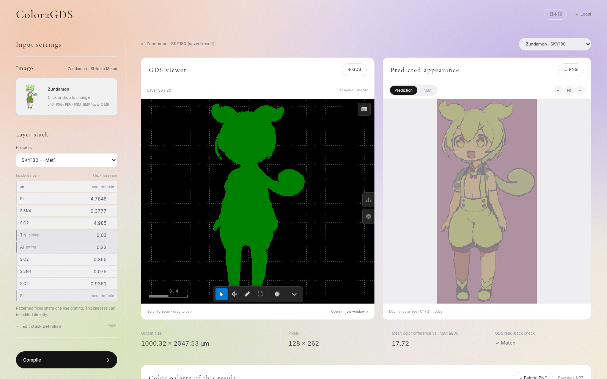

# Color2GDS

[](LICENSE)

**English** | [日本語](README.ja.md)

**Color2GDS turns an image and a layer stack into a GDSII layout that shows the image as structural color, plus a prediction of what it will look like.**

It builds sub-wavelength metal line gratings on a CMOS metal layer, computes their reflection spectra with RCWA, maps every image pixel to the closest-looking grating, and then reads the generated GDS back to recompute the predicted appearance from the actual geometry.


> [!WARNING]
> Color2GDS is a research tool. Its output is a **model prediction**. It does not guarantee color reproduction on a real chip and is **not** a manufacturing sign-off.

## Fabricated chips

Photographs of chips fabricated from layouts generated by Color2GDS.

<table>
  <tr>
    <td align="center"></td>
    <td align="center"></td>
    <td align="center"></td>
  </tr>
  <tr>
    <td align="center">Zundamon</td>
    <td align="center">Shikoku Metan</td>
    <td align="center">Red Fuji</td>
  </tr>
</table>

Zundamon and Shikoku Metan are characters of the Tohoku Zunko / Zundamon Project, used under its [character guidelines](https://zunko.jp/guideline.html). Red Fuji is Katsushika Hokusai's *South Wind, Clear Sky*, and its source image is a public domain work from [The Metropolitan Museum of Art](https://www.metmuseum.org/art/collection/search?q=JP2568) (JP2568).

## Features

- **Image in, GDS out.** JPEG / PNG / PBM / PGM / BMP input. Transparent PNG pixels become "no metal".
- **Process-aware.** Set minimum width and spacing, pixel size, pixel count and GDS layer. Includes presets for **SKY130** and **SOI + Al**, and any stack can be described in YAML or JSON.

## Quick start

Dependencies are managed with [uv](https://docs.astral.sh/uv/). It sets up Python 3.10 and every package from `uv.lock` for you. Tested on Ubuntu (WSL) on CPU. The web GUI does not need Node.js.

Install uv first if you do not have it yet. On Windows, run everything inside [WSL](https://learn.microsoft.com/windows/wsl/install).

```bash
curl -LsSf https://astral.sh/uv/install.sh | sh
```

Open a new terminal afterwards so that the `uv` command is found. See the [uv installation guide](https://docs.astral.sh/uv/getting-started/installation/) for other methods.

Then clone the repository, install the dependencies and start the web GUI.

```bash
git clone https://github.com/kadomoto-lab/color-to-gds.git
cd color-to-gds
uv sync
uv run run_web.py
```

Open **http://localhost:8765** (or http://127.0.0.1:8765). Use `--port 8766` to pick another port.

Material data and fonts ship with the repository. On first launch the server downloads a pinned [kwasm](https://pypi.org/project/kwasm/0.2.26/) viewer and checks its SHA-256. After that, images, GDS files and optical calculations stay on your machine.

### Using the web GUI



1. Choose an image on the left, or pick one of the bundled samples (Zundamon is loaded by default).
2. Pick **SKY130** or **SOI + Al** and edit the film thicknesses if needed.
3. Set the minimum width and spacing, pixel size, number of columns, GDS layer and angle of incidence.
4. Click **Compile**. When it finishes, the GDS viewer and the predicted image on the right update together.
5. Zoom and pan the GDS, compare against the input, and download the outputs.

By default the layout is 128 pixels wide at 7.815 µm per pixel, about 1 mm across. Results are written to `runs/web/<job-id>/output/`. See the [Web GUI guide](docs/WEB_GUI.md) (Japanese) for limits, the job queue and viewer details.

## Command-line usage

```bash
uv run python -m color2gds compile samples/zundamon.png \
  --stack presets/soi_al.yaml \
  --min-width-um 0.14 --min-space-um 0.14 --gds-layer 1 \
  --pixel-size-um 7.815 --columns 128 --out runs/my_soi
```

For SKY130, use `--stack presets/sky130.yaml --gds-layer 68`. The compiler will not write into an existing non-empty output folder.

To recompute only the appearance of an existing GDS

```bash
uv run python -m color2gds simulate runs/my_soi/image.gds \
  --manifest runs/my_soi/manifest.json --out runs/my_soi_resim
```

For every option, the stack schema and the NPZ layout, see the [compiler reference](docs/COMPILER.md) (Japanese).

## Outputs

| File | Contents |
|---|---|
| `image.gds` | Hierarchical GDSII, verified by reading it back |
| `appearance.png` | Appearance predicted from the GDS geometry |
| `image.bmp` | Binary map of which pixels contain metal (not a raster of the fine gratings) |
| `appearance.npz` | Wavelengths, per-cell reflectance and color, pixel-to-cell index |
| `manifest.json` | Stack, dimensions, simulation settings and input image hash |
| `summary.json` / `readback.json` | Color error, search history and geometry checks |
| `report.html` | Self-contained offline report comparing input and prediction |

Loading the spectra in Python

```python
import numpy as np
a = np.load("runs/my_soi/appearance.npz")
R = a["cell_reflectance"][a["pixel_cell_indices"][row, column]]  # reflectance spectrum of one pixel
```

## How it works

1. **Candidate library.** Generate rectangular line gratings that obey the minimum width, spacing and grid, and write them to a calibration GDS.
2. **Read back and simulate.** Extract the actual widths, periods and lengths from that GDS and compute their reflection spectra with RCWA.
3. **Assign and refine.** Map each image pixel to a grating by color difference, then search ±1 grid step around the most-used cells.
4. **Verify.** Write the final GDS, read it back, recompute the appearance from the polygons and check that it matches the model.

"Closed loop" here means GDS read-back and recomputation. It does not mean feedback from measured chips or a global optimum over all shapes.

The default settings are 31 Fourier modes, 380–780 nm in 1 nm steps, normal incidence, unpolarized light, D65 illuminant, color from the zeroth-order specular reflection. The edges of finite pixels are not solved directly. Grating and empty areas are averaged by area.

## Supported stacks

| Preset | Structure | Notes |
|---|---|---|
| [SKY130](presets/sky130.yaml) | Met1 Al grating with dielectrics and passivation | Based on public dimensions. Some optical constants (e.g. polyimide, the 30 nm TiN cap) are assumed |
| [SOI + Al](presets/soi_al.yaml) | Al 100 nm / Si 220 nm / BOX 2 µm / Si substrate | Assumed dimensions for comparison, not guaranteed values for any specific SOI process |

More example stacks are in [`presets/`](presets/). The model supports isotropic planar stacks where all patterned films share one 1D rectangular line grating.

## Repository layout

| Path | Purpose |
|---|---|
| `color2gds/` | Optical model, GDS writer/reader and closed-loop compiler |
| `presets/` | Layer stack definitions |
| `webgui/`, `run_web.py` | Web GUI and local server |
| `docs/` | Web GUI guide, compiler reference and images |
| `data/` | Optical material data and its sources |
| `samples/` | Sample input images |
| `runs/<stack>_<sample>/` | Stored case studies |
| `research/` | Earlier SKY130 optical exploration (see [research notes](research/README.md)). Its assumptions differ from the current presets |
| `scripts/` | Case report, DRC and maintenance helpers |
| `tests/` | Tests |
| `pyproject.toml`, `uv.lock` | Dependencies, managed with uv |

## Acknowledgments

- [@rire-ihn](https://github.com/rire-ihn) contributed the layer stack presets, the palette view and reflection spectrum display in the web GUI.

## Contributing

Bug reports, questions and pull requests are welcome. See [CONTRIBUTING.md](CONTRIBUTING.md).

## Citation

If you use Color2GDS in academic work, please cite it using [CITATION.cff](CITATION.cff). You can also use the "Cite this repository" link in the About section on the right of the GitHub page.

## License

Color2GDS is released under the [MIT License](LICENSE).

### Third-party components

Bundled and downloaded third-party material keeps its own license. This includes the GDS viewer, the fonts, the optical constants and the sample illustrations (see [`samples/README.md`](samples/README.md)), which are not covered by the MIT License.
